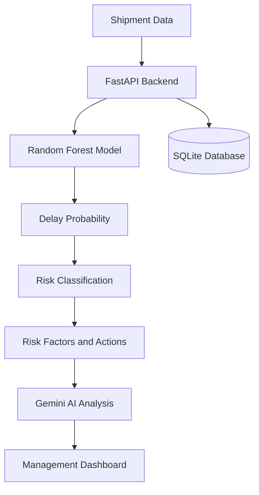

# AI Operations Manager

An AI-powered operations management system that predicts shipment delays, identifies operational risks, and provides management recommendations.

The project combines machine learning, generative AI, FastAPI, SQLAlchemy, SQLite, and an interactive web dashboard.

## Project Overview

The system helps operations and logistics teams identify shipments that may be delayed before the delivery deadline is missed.

For each shipment, the system:

1. Collects current shipment information.
2. Calculates the probability of delay using a machine-learning model.
3. Classifies the shipment as Low, Medium, or High risk.
4. Identifies the operational factors contributing to the risk.
5. Recommends actions to reduce the probability of delay.
6. Uses Gemini AI to generate a professional management assessment.
7. Stores the prediction in a local database for monitoring.

## Main Features

- Shipment delay probability prediction
- Low, Medium, and High risk classification
- Automatic risk-factor identification
- Recommended operational actions
- AI-generated executive summary
- AI-generated operational impact analysis
- Management recommendations
- Critical shipment urgency classification
- Shipment risk register
- Actual shipment outcome tracking
- Task management
- Employee management and task assignment
- Operations reports
- PDF report generation
- REST API documentation using Swagger
- Responsive web dashboard

## Technologies Used

- Python
- FastAPI
- Uvicorn
- SQLAlchemy
- SQLite
- Pydantic
- Scikit-learn
- Random Forest Classifier
- Pandas
- Joblib
- Google Gemini API
- HTML
- CSS
- JavaScript

## System Architecture



## Machine-Learning Model

The shipment delay model uses a Random Forest Classifier.

### Input Features

- Shipment distance
- Dispatch delay hours
- Days remaining before the deadline
- Documentation completion status
- Vehicle availability
- Shipment priority
- Transport type
- Current shipment stage

### Model Output

- Delay probability
- Risk level
- Delay prediction
- Risk factors
- Recommended actions

### Model Evaluation

| Metric | Score |
|---|---:|
| Accuracy | 0.768 |
| Precision | 0.804 |
| Recall | 0.767 |
| F1 Score | 0.785 |
| ROC AUC | 0.852 |

## Important Model Limitation

The current model was trained using synthetic demonstration data.

The evaluation results demonstrate the technical workflow, but they do not prove production performance.

Before company deployment, the model should be retrained and validated using historical shipment data from the organization.

## AI Management Analysis

After the machine-learning model calculates the shipment risk, Gemini AI generates:

- Executive summary
- Operational impact assessment
- Urgency level
- Management recommendation
- Prioritized recommended actions

The AI does not replace the machine-learning prediction. It explains the prediction in a format that is useful for operations managers.

## Example Prediction

```text
Shipment: SH-1001
Route: Jeddah to Riyadh
Delay Probability: 93.2%
Risk Level: High
Prediction: Likely Delayed
Urgency: Critical
```

Example risk factors:

- Shipping documents are incomplete.
- A transport vehicle is unavailable.
- The shipment has a significant dispatch delay.
- Very little time remains before the delivery deadline.
- The shipment must travel a long distance.

## Project Structure

```text
AI-Operations-Manager/
│
├── app.py
├── main.py
├── database.py
├── models.py
├── ai_agent.py
├── shipment_routes.py
├── shipment_ai_routes.py
├── risk_predictor.py
├── train_model.py
├── shipment_dashboard.html
├── index.html
├── requirements.txt
├── .gitignore
├── .env
├── shipment_delay_model.joblib
└── shipment_training_data.csv
```

## Installation

### 1. Clone the repository

```bash
git clone YOUR_REPOSITORY_URL
cd AI-Operations-Manager
```

### 2. Create a virtual environment

Windows PowerShell:

```powershell
python -m venv .venv
```

### 3. Install the required packages

```powershell
.\.venv\Scripts\python.exe -m pip install -r requirements.txt
```

### 4. Create the environment file

Create a file named:

```text
.env
```

Add your Gemini API key:

```env
GEMINI_API_KEY=your_api_key_here
```

Never upload the `.env` file or expose the API key publicly.

### 5. Train the model

```powershell
.\.venv\Scripts\python.exe train_model.py
```

This command creates:

```text
shipment_delay_model.joblib
shipment_training_data.csv
```

### 6. Start the application

```powershell
.\.venv\Scripts\python.exe -m uvicorn app:app --reload
```

## Application URLs

Shipment dashboard:

```text
http://127.0.0.1:8000/shipment-dashboard
```

API documentation:

```text
http://127.0.0.1:8000/docs
```

Operations Manager:

```text
http://127.0.0.1:8000/
```

## Main API Endpoints

| Method | Endpoint | Purpose |
|---|---|---|
| POST | `/shipments/predict` | Predict and save shipment risk |
| GET | `/shipments` | Retrieve saved shipments |
| GET | `/shipments/summary` | Retrieve risk statistics |
| GET | `/shipments/{shipment_id}` | Retrieve one shipment |
| PATCH | `/shipments/{shipment_id}/actual-status` | Record the actual outcome |
| DELETE | `/shipments/{shipment_id}` | Delete a shipment |
| POST | `/shipments/{shipment_id}/ai-analysis` | Generate an AI management analysis |

## Business Value

The system can help logistics and operations teams:

- Detect high-risk shipments early.
- Prioritize critical operational cases.
- Reduce manual monitoring effort.
- Understand the reasons behind predicted delays.
- Take preventive action before a deadline is missed.
- Create a central record of shipment risks.
- Compare predictions with actual shipment outcomes.
- Support operations managers with concise assessments.

## Future Improvements

- Train the model using real company data.
- Import multiple shipments from CSV or Excel.
- Connect the system to an ERP or transportation system.
- Add authentication and user roles.
- Send automatic high-risk alerts by email.
- Generate shipment risk reports in PDF.
- Add prediction monitoring and model retraining.
- Deploy the application to a cloud platform.
- Add charts showing monthly delay trends.
- Support Arabic and English interfaces.

## Disclaimer

This project is a portfolio demonstration and decision-support prototype.

Predictions and AI recommendations should be reviewed by an authorized operations professional before business decisions are made.